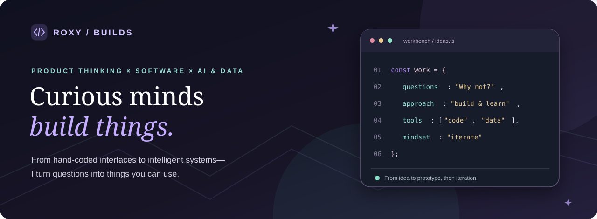

  
  <h1>Hey, I'm Roxy 👋</h1>
  
<strong>Product-minded builder · Software & AI · Data-informed problem solving</strong>

  
I like taking an idea from <em>“what if?”</em> to something people can actually use.

  
<strong>TECH STACK</strong>

  
<strong>LANGUAGES</strong>

  

    
    
    
    
    
    
    
    
  

  
<strong>FRONTEND & VISUALIZATION</strong>

  

    
    
    
    
    
    
    
    
  

  
<strong>BACKEND & DATABASES</strong>

  

    
    
    
    
    
    
    
  

  
<strong>AI & DATA</strong>

  

    
    
    
    
    
    
  

  
<strong>DEVELOPER TOOLS</strong>

  

    
    
    
    
    
  

---

## What I'm about

My route into software started with **writing the code myself**: React components, JavaScript logic, styles and small backends. That hands-on foundation still shapes how I work.

Today I enjoy building at the intersection of **product design, AI-powered applications and applied analytics**—from making believable character experiences to designing interactive planning tools and exploring financial risk models.

Rather than collecting badges, I like connecting three perspectives:

<table>
  <tr>
    <td width="33%" align="center"><strong>01 · Product</strong> What is the real problem, and who cares?</td>
    <td width="33%" align="center"><strong>02 · Engineering</strong> How do we turn it into a working system?</td>
    <td width="33%" align="center"><strong>03 · Evidence</strong> What can we measure, test or learn?</td>
  </tr>
</table>

## Featured builds

### ✨ New worlds, smarter workflows

<table>
  <tr>
    <td width="52%" valign="top">
      
      <h3><a href="https://github.com/Roxyh-code/Echoloom_marketplace">Echoloom</a></h3>
      
<strong>Character marketplace × AI storytelling</strong>

      
A mobile-first studio for creating and publishing original characters, casting two of them into a shared scene and directing how the story unfolds.

      
Next.js · React · TypeScript · FastAPI · LangGraph · Python

      
<a href="https://github.com/Roxyh-code/Echoloom_marketplace/tree/main/demo">▶ See the recorded demo</a>

    </td>
    <td width="48%" valign="top">
      
      <h3><a href="https://github.com/Roxyh-code/StudyFlow">StudyFlow</a></h3>
      
<strong>Adaptive academic workload planning</strong>

      
A high-fidelity React prototype for scheduling around real constraints, tracking tasks, visualizing workload and exploring AI-assisted study planning.

      
React · Vite · Tailwind CSS · Scheduling algorithms

      
<a href="https://study-flow-liard.vercel.app/">↗ Try the live prototype</a>

    </td>
  </tr>
</table>

### 🛠 Before AI-assisted coding: built by hand

These earlier projects are especially meaningful to me: I designed the components and wrote the application logic directly, learning the fundamentals rather than relying on generated code.

<table>
  <tr>
    <td width="50%" valign="top">
      
      <h3><a href="https://github.com/Roxyh-code/CoolPaws">CoolPaws 🐾</a></h3>
      
Pet-care dashboard with wellness metrics, schedules, a searchable park directory and a Leaflet map.

      
React · JavaScript · React Router · Leaflet · CSS

    </td>
    <td width="50%" valign="top">
      
      <h3><a href="https://github.com/Roxyh-code/Brainflix">Brainflix ▶</a></h3>
      
A responsive video-site interface with dynamic pages, recommendations and an Express API for reading and creating video metadata.

      
React · Sass · Axios · Node.js · Express

    </td>
  </tr>
</table>

<small>The CoolPaws and Brainflix images are intended as genuine browser captures of their original React interfaces, with any necessary legacy compatibility fixes disclosed in those project READMEs. The Echoloom and StudyFlow banners are illustrative.</small>

## Numbers with a purpose

Instead of profile trophies or a contribution streak, here are **actual visualizations produced by my analytical projects**. For me, a chart is useful when it makes a question easier to answer.

<table>
  <tr>
    <td width="50%" valign="top">
      
      
<strong>Risk isn't one number.</strong> Options sensitivity and downside exposure under different spot/volatility combinations.

    </td>
    <td width="50%" valign="top">
      
      
<strong>Turning curves into factors.</strong> Principal-component analysis of interest-rate movements.

    </td>
  </tr>
</table>

**[Multi-Asset Risk & Volatility Analytics](https://github.com/Roxyh-code/multi-asset-risk-analytics)** — independent Python analysis spanning VaR, volatility strategies, interest-rate PCA and portfolio stress testing. Some modules use synthetic/illustrative inputs, identified in the project.

**[Second Cup — UTCC Financial Modeling](https://github.com/Roxyh-code/Second_Cup)** — scenario analysis and quantitative decision support for a business case, including sensitivity testing and transparent model assumptions.

## A little more human

I love projects that combine **engineering with a reason to exist**: the small interaction that makes a product more intuitive, the story beat that makes a character feel coherent, or the analysis that turns assumptions into an informed decision.

If something connects product design, intelligent systems or applied analytics, there's a good chance I'll want to explore it.

  
<strong>Build something useful. Learn something unexpected. Repeat.</strong>

  
<a href="https://github.com/Roxyh-code?tab=repositories">Browse all repositories</a> · <a href="https://github.com/Roxyh-code/Echoloom_marketplace/issues">Discuss Echoloom</a>

